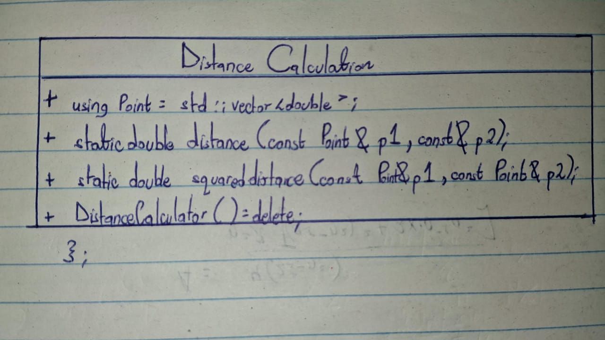

# SEBBOWA MASAMBILA ABRAHAM 25/U/04087/PS

# Week 3 Report: Distance Calculation

This report explains how inheritance, polymorphism, and encapsulation apply to the distance calculation code. It also gives a class layout that can be copied onto paper.

## Class Layout

## Encapsulation

Encapsulation means grouping related types and actions together and controlling how they are used. `DistanceCalculator` groups the `Point` type and the distance functions in one class. The points are passed into the functions, and the results are returned to the caller. The class does not keep or change point data itself.

All listed members are public. There is no private data in this class. Its constructor is deleted, so the functions are used directly through the class name instead of through an object.

## Inheritance

Inheritance lets one class build on another class. `DistanceCalculator` does not inherit from another project class, and no class in this feature inherits from it. Inheritance is not used here.

## Polymorphism

Polymorphism lets different classes provide their own versions of the same function, often using virtual functions. This class has no virtual functions and does not override a function from a parent class. Polymorphism is not used here.

## How the Class Is Used

The rest of the program can call `DistanceCalculator::distance(point, centroid)` to get the actual distance, or `DistanceCalculator::squareddistance(point, centroid)` when only comparing which point is closer. The functions check the dimensions and values before calculating. The test file checks examples in one or more dimensions, including empty points, and checks that invalid inputs are rejected.

## Summary

`DistanceCalculator` is a utility class with two static distance functions and no stored member data. It keeps related calculations together. Inheritance and polymorphism are not part of the current implementation.
