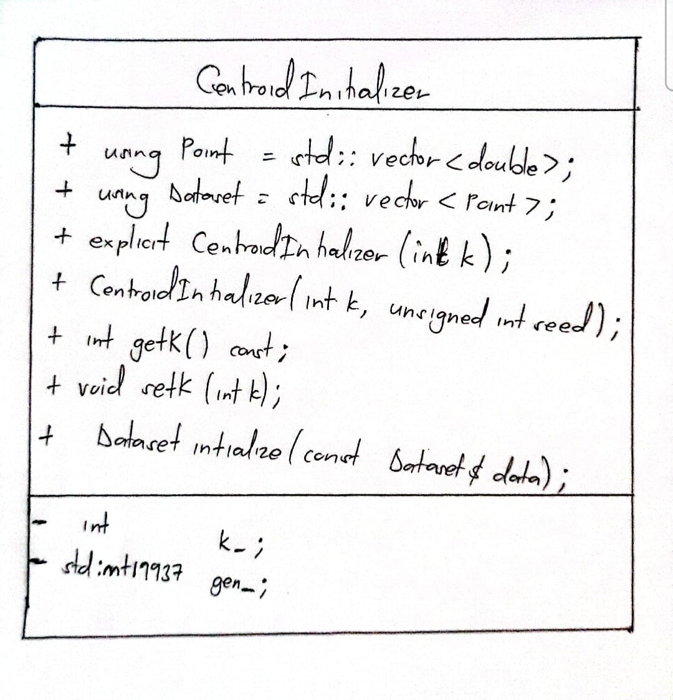

# BUSULWA GERRYSON ISRAEL 25/U/0826 BELE

# Week 3 Report: Class Design in Centroid Initialization

This report explains how inheritance, polymorphism, and encapsulation appear in my centroid initialization code. It also shows the class layout in a simple text diagram.

## Class Layout

The class uses `public` for the parts that other code needs to call. The stored values are `private`, so they can only be changed through the class's functions. There is no `protected` member in this class.

## Encapsulation

Encapsulation means keeping data and the functions that use it together, while controlling direct access to that data. `CentroidInitializer` does this by keeping `k_` and `gen_` private. Other code uses `getK()`, `setK()`, and `initialize()` instead of changing those values directly.

The setter also checks that `k` is at least 1 before changing `k_`. The initializer checks that the dataset is valid before choosing points. These checks help prevent invalid settings and input from being used.

## Inheritance

Inheritance lets one class build on another class. The `CentroidInitializer` class does not inherit from another project class, and no project class inherits from it. So inheritance is not used in this feature.

## Polymorphism

Polymorphism lets related classes provide different versions of the same function, often through virtual functions. This feature has one class and does not declare virtual functions or override a parent class's functions. So polymorphism is not used here.

## How the Class Is Used

Other code can create a `CentroidInitializer` with the required number of centroids. It can optionally give a seed to make random choices repeatable. Then it passes the dataset to `initialize()`. The function returns the selected data points, which can be used as the K-Means starting centroids. The test file creates and calls this class to check its behavior.

## Summary

The main object-oriented idea used in this feature is encapsulation: the class keeps its settings private and provides public functions to work with them. Inheritance and polymorphism are not part of the current implementation.

