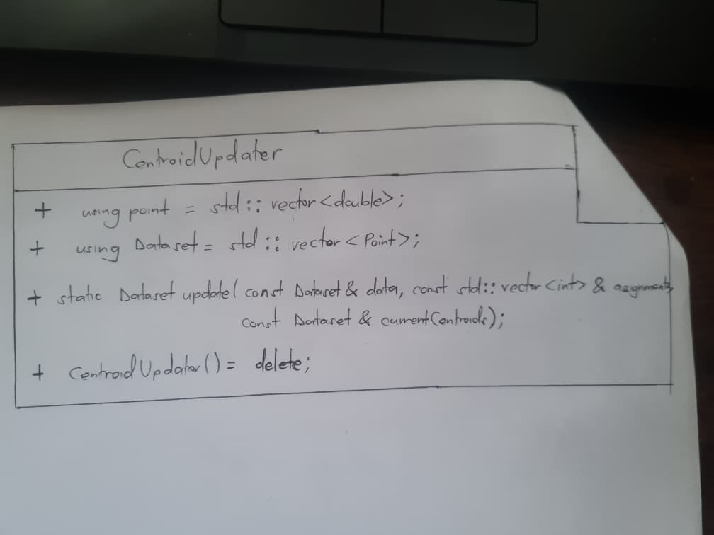

# Week 3 Report: Class Design in Centroid Update

This report explains how inheritance, polymorphism, and encapsulation apply to the centroid update code. It also gives a simple class layout that can be copied onto paper.

## Class Layout

When drawing it by hand, make one box with three sections: class name, public members, and private members. Write “none” in the private section. You can note that there are no protected members or stored member data.

## Encapsulation

Encapsulation means organizing related types and actions together and controlling access to them. `CentroidUpdater` groups the centroid update operation and the `Point` and `Dataset` type names in one class. Its inputs are passed into the function, and it returns new centroids without changing the original data.

This class has no private data to protect. Its members are public, and its constructor is deleted so users call the static function directly without creating an object.

## Inheritance

Inheritance lets one class build on another class. `CentroidUpdater` does not inherit from another class, and no class in this feature inherits from it. Inheritance is not used here.

## Polymorphism

Polymorphism lets different classes provide their own versions of the same function, often using virtual functions. `CentroidUpdater` has no virtual functions and does not override a function from a parent class. Polymorphism is not used here.

## How the Class Is Used

The rest of the program calls `CentroidUpdater::update(data, assignments, currentCentroids)`. The function checks the inputs, calculates each cluster's average, and returns the updated centroids. A cluster with no assigned points keeps its previous centroid. The test file calls the function with different datasets to check these results and its error handling.

## Summary

`CentroidUpdater` is a utility class with one static update function and no stored member data. The code groups related work together, but it does not use inheritance or polymorphism.
