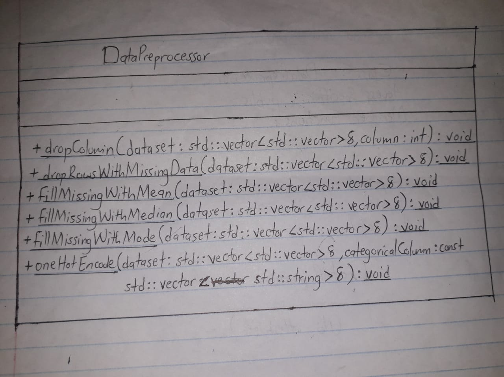

#  Week 3 report
# SSEGAWA JASIFA
# 25/U/08782/PS
# BCCE

## Overview

This report documents the implementation of core Object-Oriented Programming concepts—encapsulation, inheritance, and polymorphism on the `DataPreprocessor` module.

## 1. Encapsulation

Encapsulation is the bundling of data and the methods that operate on that data into a single unit, as well as restricting direct access to some of the object's components.

**Implementation in `DataPreprocessor`:**
In the provided `DataPreprocessor.hpp` and `DataPreprocessor.cpp` files, encapsulation is utilized to group related dataset manipulation functions together. The class `DataPreprocessor` encapsulates the following statically accessible behaviors under the `public` access specifier:

* `dropColumn`

* `dropRowsWithMissingData`

* `fillMissingWithMean`

* `fillMissingWithMedian`

* `fillMissingWithMode`

* `oneHotEncode`

Currently, the `DataPreprocessor` acts as a static utility class. It does not contain `private` or `protected` member data, since all methods operate directly on the dataset references passed to them.

## 2. Inheritance

Inheritance allows a class to inherit properties and behaviors from another class.

**Implementation in `DataPreprocessor`:**
Currently, inheritance is not implemented within the `DataPreprocessor` module. The `DataPreprocessor` is a standalone utility class that does not derive from any base class, nor does it serve as a base class for any derived classes.

## 3. Polymorphism

Polymorphism allows methods to do different things based on the object it is acting upon, typically implemented via virtual functions.

**Implementation in `DataPreprocessor`:**
Polymorphism is not utilized in the `DataPreprocessor` class. Since the class consists entirely of static utility functions and does not participate in an inheritance hierarchy, there are no overridden virtual methods or dynamic binding implemented in this module.

## 4. Class Layout Drawings

