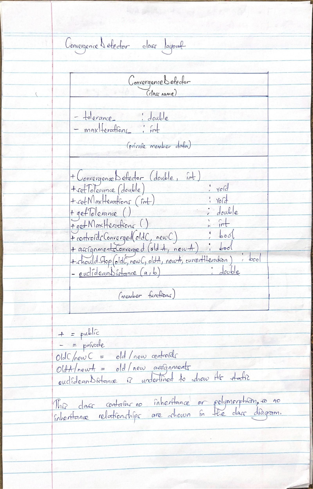

NANDYOWA PATIENCE VALERIA 25/U/0851
# Week 3 Progress Report

## Inheritance, Polymorphism and Encapsulation in the Convergence Detector

### Encapsulation
Encapsulation is the principle this class actually uses.

- `tolerance_` and `maxIterations_` are private. The only ways to change them are the constructor and the two setters, and all three reject bad values (a negative or non-finite tolerance, or fewer than 1 iteration) by throwing `std::invalid_argument`. Code outside the class can't leave a detector in an invalid state.
- `euclideanDistance` is private and static. It's an implementation detail, and nothing outside the class needs to call it.
- Callers only see three yes/no questions: `centroidsConverged`, `assignmentsConverged` and `shouldStop`. 
There are also two read-only getters, `getTolerance` and `getMaxIterations`, which return copies of values so callers can read settings but cant change them. Callers don't need to know how the distance is calculated or compared with the tolerance, so I could change that later without touching any code that uses the class.

### Inheritance
Right now the class isn't part of any inheritance hierarchy. It has one job, and there aren't any other stopping strategies yet that would need to share a base class. Adding one now would just be extra code with nothing using it.

If the project later needs more than one strategy, I could pull out an interface. For example, a "strict" detector could require both the centroids and the assignments to be stable, while a "relaxed" one stops when either is. The current `shouldStop` is the relaxed kind and also stops once `currentIteration` reaches `maxIterations` so the loop cant run forever.

### Polymorphism
Polymorphism wasn't used in this class. None of the member functions are virtual, so there's no run-time polymorphism. There's no compile-time version either (templates, for example). Creating objects with different tolerance and iteration values is within normal use of one class.

### Summary of design decisions
| Principle     | How it appears in ConvergenceDetector                                        |
|---------------|------------------------------------------------------------------------------|
| Encapsulation | Private data, validated in the constructor and setters; public yes/no checks |
| Inheritance   | Not used (one responsibility, no variants needed yet)                        |
| Polymorphism  | Not used (no virtual functions, no templates)                                |

